# Fusion Check-In: Software Documentation

**Version:** v1.0
**Date:** October 20, 2026
**Repository:** github.com/saibharathuwin/fusion-check-in
**Live application:** fusion-check-in-567.pages.dev

Admin web application for the University of Windsor's Fusion Innovation and Entrepreneurship
Network: student management, event management, and QR code check-in.

## Table of Contents

1. [Introduction](#1-introduction)
2. [System Overview](#2-system-overview)
3. [Functional Requirements](#3-functional-requirements)
4. [Non-Functional Requirements](#4-non-functional-requirements)
5. [Technology Stack](#5-technology-stack)
6. [System Architecture](#6-system-architecture)
7. [Project Structure](#7-project-structure)
8. [Database Design](#8-database-design)
9. [Check-In Logic](#9-check-in-logic)
10. [Module Descriptions](#10-module-descriptions)
11. [User Workflows](#11-user-workflows)
12. [UML Diagrams](#12-uml-diagrams)
13. [Security](#13-security)
14. [Deployment Guide](#14-deployment-guide)
15. [Installation and Local Setup](#15-installation-and-local-setup)
16. [Testing](#16-testing)
17. [Known Issues and Limitations](#17-known-issues-and-limitations)
18. [Future Improvements](#18-future-improvements)
19. [Maintenance and Troubleshooting](#19-maintenance-and-troubleshooting)
20. [Appendix A: Glossary](#20-appendix-a-glossary)
21. [Appendix B: Change Log](#21-appendix-b-change-log)

---

## 1. Introduction

### 1.1 Purpose

This document describes the design, architecture, database, and behaviour of Fusion Check-In, the
administrative web application used by the University of Windsor's Fusion Innovation and
Entrepreneurship Network. It is written for anyone who needs to understand, maintain, extend, or
operate the system: a new developer joining the project, a reviewer, or the project owner
themselves at a later date.

### 1.2 Scope

This document covers the application exactly as deployed: the React/TypeScript front end, the
Supabase (Postgres) backend, the database schema and functions, the check-in and attendance logic,
authentication and access control, and the deployment pipeline to Cloudflare Pages. It does not
cover the content of the SQL migration files line by line; instead it describes the resulting,
current state of the schema, with the file each piece came from noted for traceability.

### 1.3 Audience

| Reader | What this document gives them |
|---|---|
| Developer maintaining or extending the app | Architecture, module map, database design, and the exact check-in rules |
| Project owner / stakeholder | A plain description of what the system does and how it is organized |
| Operator deploying or supporting the app | Deployment guide, environment variables, troubleshooting |

### 1.4 Definitions and Acronyms

| Term | Meaning |
|---|---|
| Admin | A staff account with full access to the dashboard: students, events, analysis, and settings |
| Staff | A staff account used to scan passes by hand at an event, from a personal phone |
| Kiosk | A shared, non-personal account used on one fixed device left at an event's entrance for self-serve check-in |
| Student | A person in the Fusion network who holds a QR pass and attends events |
| Event | A Fusion activity that students check into, made up of one or more Sessions |
| Session | One check-in period of an event, with its own open/close window and scheduled start time |
| Pass | A student's personal QR code, used to identify them at check-in |
| Check-in | A recorded instance of a student being scanned or manually marked present at a session |
| Invite-only event | An event type where only specifically invited students may check in |
| RLS | Row Level Security: Postgres's built-in mechanism for restricting which rows a query can see or change |
| RPC | Remote Procedure Call: a named Postgres function the app calls directly, instead of a plain table query |
| SPA | Single-Page Application: a web app that loads once and updates its content in place, without full page reloads |
| UML | Unified Modeling Language: the diagram notation used throughout Section 12 |

---

## 2. System Overview

### 2.1 Problem Statement

Before this system, tracking who attended a Fusion event, and whether they arrived on time, had no
single reliable source of truth. Fusion Check-In replaces that with one web application that every
staff member and student interaction goes through: students carry one QR pass, staff create events
with their own check-in rules, and every scan is recorded centrally, instantly, and consistently,
whether it happens at a self-serve kiosk or in a staff member's hand.

### 2.2 Users

| User | Role in the system |
|---|---|
| Admin | Manages students, creates and edits events, reviews live attendance and post-event reports, manages staff accounts |
| Staff | Scans student passes at an event using their own phone; can check a student in manually if scanning fails |
| Kiosk | Not a person but a shared device role: a tablet or phone left propped up at an event entrance so students can scan themselves in |
| Student | Holds a QR pass and checks into events; has no login of their own and never signs in to the system |

### 2.3 Key Features

- Student directory with manual entry and bulk CSV/Excel import
- Printable QR pass for every student
- Event creation with Open, Limited, or Invite-only registration, and single or multi-day sessions
- Per-student invite history for Invite-only events, including joining late or being dropped
- One shared QR scanner used in both Kiosk and Staff mode
- Real-time live monitoring of an in-progress event, with an instant check-in feed
- Manual check-in and undo, for when scanning is not possible
- Post-event analysis: attendance by day, by session, and by faculty, no-shows, and late joiners
- CSV export of attendance
- Org-wide student analytics: faculty distribution, status breakdown, join trends
- Role-based access, enforced in both the application and the database

---

## 3. Functional Requirements

The functional requirements below describe what the system does, derived directly from its
implemented behaviour.

- **FR-1.** The system shall allow an Admin to add a student individually, with first name, last name, and email required, and faculty, program, level, year, and student number optional.
- **FR-2.** The system shall allow an Admin to import students in bulk from a .csv or .xlsx file, auto-mapping columns where possible and flagging rows that fail validation.
- **FR-3.** The system shall generate exactly one QR pass per student, encoding a random token rather than any identifying student information.
- **FR-4.** The system shall allow an Admin to reprint or re-download a student's pass as a PDF at any time.
- **FR-5.** The system shall allow an Admin to create an event with a registration type of Open, Limited, or Invite-only, and one or more check-in sessions.
- **FR-6.** The system shall allow an Admin to edit or delete an event, subject to data-safety rules (see FR-18).
- **FR-7.** The system shall allow an Admin to manage the invite list of an Invite-only event: adding a student (optionally starting partway through the event), and dropping a student (optionally with a reason).
- **FR-8.** The system shall allow a Student to be scanned at a Kiosk device using their QR pass to record a check-in.
- **FR-9.** The system shall allow a Staff member to scan a student's QR pass using their own device to record a check-in.
- **FR-10.** The system shall allow a Staff member or Admin to manually check a student in by searching for them by name or student number, without a QR scan.
- **FR-11.** The system shall allow a Staff member or Admin to undo a check-in that was made in error.
- **FR-12.** The system shall reject a check-in attempt outside a session's check-in window, unless the check-in is manual.
- **FR-13.** The system shall reject a check-in attempt for an Invite-only event from a student who is not currently invited.
- **FR-14.** The system shall reject a check-in attempt for a Limited event once the event has reached its capacity.
- **FR-15.** The system shall record each check-in as exactly one of Early, On time, or Late, based on the session's scheduled start time and grace period.
- **FR-16.** The system shall prevent the same student from being checked into the same session more than once.
- **FR-17.** The system shall display a live, real-time view of check-ins for an event currently in progress, updating without a manual page refresh.
- **FR-18.** The system shall prevent deleting a session that already has check-ins recorded against it, and shall warn an Admin before deleting an event that has enrollments, invitees, or check-ins.
- **FR-19.** The system shall produce a post-event report for a Completed event, showing attendance broken down by day, by session, and by faculty.
- **FR-20.** The system shall identify students who were invited to an Invite-only event but never checked in to any session (no-shows).
- **FR-21.** The system shall identify students who were added to an Invite-only event's roster after the event had already started.
- **FR-22.** The system shall allow an Admin to export an event's attendance list as a CSV file.
- **FR-23.** The system shall provide org-wide student analytics: counts by faculty, by status, join trends over time, and a ranking of the most active students.
- **FR-24.** The system shall require a signed-in session for every page except the login, kiosk sign-in, and staff scanner sign-in pages.
- **FR-25.** The system shall restrict the full admin dashboard to accounts with the Admin role.
- **FR-26.** The system shall allow a user to choose whether their sign-in session persists after closing the browser ("stay signed in").

---

## 4. Non-Functional Requirements

### 4.1 Performance

- **NFR-1.** A single QR scan decision (lookup, window check, invite check, capacity check, insert) shall complete as one round trip to the database, inside one transaction.
- **NFR-2.** The QR decode loop shall downscale each camera frame before searching it for a code, to keep scanning responsive on low-powered devices.
- **NFR-3.** A new check-in shall appear on the Live Monitor view within a few seconds, via a Realtime subscription, without the staff member needing to refresh the page.

### 4.2 Security

- **NFR-4.** Every database table shall have Row Level Security enabled, so access rules are enforced by Postgres itself, not only by the application's own logic.
- **NFR-5.** A pass's real token shall never be directly selectable by a client; it shall only be reachable through specific, role-checked database functions.
- **NFR-6.** A QR code shall encode only an opaque, random token, never a student number or other identifying value, so a code cannot be guessed or forged.
- **NFR-7.** Admin and Staff accounts shall be restricted to a university email domain at the database level, not only in the sign-up form.

### 4.3 Reliability

- **NFR-8.** A duplicate check-in attempt (for example, two staff scanning the same student at nearly the same moment) shall never produce two check-in rows for the same student and session; the database's own unique constraint shall guarantee this regardless of application-level timing.
- **NFR-9.** If the camera cannot be started, or the Realtime connection drops, the application shall continue to function using a fallback (a manual check-in path, and a slower periodic refresh, respectively) rather than becoming unusable.

### 4.4 Usability

- **NFR-10.** The entire application shall be fully operable using only a keyboard, with a visible focus indicator on every interactive element.
- **NFR-11.** Every check-in outcome, including every rejection, shall show the person at the scanner a clear, specific, plain-language message rather than a generic error.

### 4.5 Device and Browser Support

- **NFR-12.** The scanner shall support both the front camera (Kiosk mode) and the rear camera (Staff mode), and shall let a device remember a manual picture-mirroring correction, since front-camera mirroring behaviour varies by device.
- **NFR-13.** The live camera preview shall be drawn to an on-screen canvas rather than relying purely on CSS, because some older Android devices render video through a hardware path that silently ignores CSS transforms.
- **NFR-14.** The application shall run in a modern evergreen browser (Chrome, Edge, Safari) on desktop, tablet, and phone, without requiring an installed app.

---

## 5. Technology Stack

| Tool | Version (package.json) | Purpose |
|---|---|---|
| react, react-dom | 19.2.8 | UI framework the entire front end is built on |
| typescript | 6.0.2 | Static typing across the whole code base |
| vite | 8.3.0 | Development server and production build tool |
| @vitejs/plugin-react | 6.1.1 | React support for Vite (fast refresh, JSX) |
| tailwindcss, @tailwindcss/vite | 4.3.3 | Utility-first styling, written directly in component markup |
| react-router-dom | 7.18.4 | Client-side routing between pages |
| @supabase/supabase-js | 2.116.0 | Client library for Postgres queries, Auth, and Realtime |
| jsqr | 1.4.0 | Decodes a QR code from camera image data, in the browser |
| qrcode | 1.5.4 | Generates the QR code structure used when building a pass PDF |
| jspdf | 4.2.1 | Builds the printable pass PDF and other PDF output |
| jszip | 3.10.2 | Bundles multiple generated pass PDFs into one ZIP download |
| recharts | 3.10.1 | Charts used in Analysis and Analytics |
| papaparse | 5.7.0 | Parses .csv files during student import |
| read-excel-file | 9.3.12 | Parses .xlsx files during student import |
| fuse.js | 7.5.0 | Fuzzy text matching, used for example when matching a typed faculty name |
| validator | 13.15.35 | General-purpose input validation helpers (for example, email format) |
| vitest | 5.0.1 | Automated test runner |
| eslint, typescript-eslint | 10.10.0 / 8.69.0 | Static code linting |
| wrangler | 4.135.0 | Cloudflare's command line tool, used to deploy the built app |
| @cloudflare/workers-types | 5.20260925.1 | Type definitions for the small Cloudflare Pages Function used in deployment |

Backend platform: Supabase, providing a managed Postgres database, Supabase Auth, Supabase
Realtime, and Row Level Security. Supabase itself is a hosted service rather than a package in
package.json.

Hosting: Cloudflare Pages, serving the built static application and its small Functions bundle.

---

## 6. System Architecture

Fusion Check-In is a single-page application. The browser loads one small HTML page, and React
takes over from there, swapping screens in and out as the user navigates, without full page
reloads. There is no custom backend server written for this project: the browser talks directly to
Supabase for every data operation, for signing in, and for receiving live updates.

```
+------------------------+        HTTPS         +------------------------------+
|  Browser (React SPA)   | --------------------> |  Supabase Project            |
|  served by              | <-------------------- |   - Postgres database        |
|  Cloudflare Pages       |   Realtime (WebSocket) |   - Supabase Auth            |
+------------------------+ <-------------------- |   - Realtime service         |
                                                   |   - Row Level Security       |
                                                   +------------------------------+
```

### 6.1 Why logic lives in the database

Decisions that must always be correct, no matter which screen or device triggers them, are
implemented as Postgres functions rather than in the React code: whether a check-in is allowed
(`record_check_in`), whether an undo is permitted (`undo_check_in`), and whether a scanned token
resolves to a real pass (`lookup_pass_by_token`). Putting this logic in the database, inside one
transaction per call, means two staff members scanning the same student at nearly the same instant
can never both succeed, and the rule is identical whether the request comes from the Kiosk, the
Staff scanner, or a manual check-in.

### 6.2 Data flow for a typical page

1. React Router matches the current URL to a page component.
2. The page component calls a function in `src/data/`, which issues a Supabase query or RPC call.
3. Postgres applies its Row Level Security policies, then returns the allowed rows.
4. The page renders the result; for pages that need to stay live (the Live Monitor), a Supabase Realtime subscription is also opened, which pushes further updates as they happen.

---

## 7. Project Structure

```
fusion/
  src/
    auth/          Sign-in session handling, role checks, route protection
    components/     Shared, reusable UI pieces: modals, cards, nav, inputs, icons
    data/           All Supabase reads and writes, and the pure data-shaping logic
                     that does not depend on React (sessions, attendance, invitees)
    lib/            Small shared utilities (row activation, Supabase client, date/time)
    pages/          One folder per feature area:
                       Dashboard        - landing page and quick actions
                       Events           - event list, create/edit form
                       EventDetail      - one event's Overview, Live Monitor, Analysis
                       Scanner          - the Kiosk and Staff QR scanner
                       AddStudent       - add one student, pass preview
                       StudentDirectory - browse, search, and filter students
                       Students         - import, analytics, pass tools landing
                       PassTools        - look up a student, reprint their pass
                       Login            - Admin login, password reset
                       Settings         - staff account management
                       ComingSoon       - placeholder for not-yet-built routes
  supabase/         SQL: schema, functions, policies, one file per change, plus seed.sql
  public/           Static assets served as-is
  index.html        The single HTML page the SPA mounts into
  vite.config.ts     Build configuration
  package.json       Dependencies and scripts
```

Within `src/pages/`, this project's own convention is to keep a feature's main page and its closely
related small sub-components together in one file, rather than splitting every small piece of UI
into its own file. Data access and business logic that multiple pages share lives in `src/data/`
instead of inside any one page.

---

## 8. Database Design

The database is Postgres, managed by Supabase. There is no single consolidated schema file in the
repository; the schema is the sum of `seed.sql` and about thirty incremental `schema-*.sql` files
under `supabase/`, each adding or changing one piece of behaviour. The tables below describe the
current, merged result of all of those files, with the originating file noted for traceability.

> **Note:** the `staff_users` table's own CREATE TABLE statement is not present in any tracked SQL
> file; it predates version-controlled migrations and was created directly in the Supabase
> dashboard. Its columns below are inferred from how it is used elsewhere in the SQL files and in
> the application code, not read directly from a CREATE TABLE statement.

### 8.1 Tables

#### students

| Column | Type | Nullable | Key / Constraint |
|---|---|---|---|
| id | uuid | No | Primary key, default gen_random_uuid() |
| student_number | text | Yes | Unique; must match 9 digits when present |
| first_name | text | No | |
| middle_name | text | Yes | |
| last_name | text | No | |
| email | text | No | Unique |
| faculty | text | No | |
| program | text | No | |
| level | text | No | Check: Undergraduate or Graduate; default Undergraduate |
| year | text | No | |
| status | text | No | Check: Active, Alumni, or Withdrawn; default Active |
| created_at | timestamptz | No | Default now() |

#### student_fusion_ids

| Column | Type | Nullable | Key / Constraint |
|---|---|---|---|
| student_id | uuid | No | Primary key, foreign key to students(id), cascade delete |
| fusion_code | text | No | Unique, for example F0001 |
| created_at | timestamptz | No | Default now() |

A trigger, `assign_fusion_id_trigger`, fires after every insert into `students` and creates the
matching row here, using the Postgres sequence `fusion_id_seq` so concurrent inserts (for example,
a bulk import) can never produce a duplicate code. This code is an internal staff-facing reference
only; it is not shown to students and not printed on the pass.

#### passes

| Column | Type | Nullable | Key / Constraint |
|---|---|---|---|
| id | uuid | No | Primary key, default gen_random_uuid() |
| student_id | uuid | No | Unique, foreign key to students(id), cascade delete |
| token | text | No | Unique, default a random 32 character hex value |
| status | text | No | Check: Active or Revoked; default Active |
| created_at | timestamptz | No | Default now() |

Exactly one pass per student. Direct read access to this table's `token` column is blocked for
every client; see Section 13.

#### events

| Column | Type | Nullable | Key / Constraint |
|---|---|---|---|
| id | uuid | No | Primary key, default gen_random_uuid() |
| program | text | No | The event's name |
| event_type | text | No | |
| semester | text | Yes | |
| year | text | Yes | |
| description | text | Yes | |
| start_date, end_date | date | No | |
| start_time, end_time | time | No | |
| location | text | No | |
| capacity | integer | No | Default 0 |
| registration_type | text | Yes | Check: Open, Limited, or Invite-only |
| status | text | No | Check: Upcoming, Active, or Completed |
| status_mode | text | No | Check: Automatic or Manual; default Automatic |
| created_at | timestamptz | No | Default now() |

#### sessions

| Column | Type | Nullable | Key / Constraint |
|---|---|---|---|
| id | uuid | No | Primary key, default gen_random_uuid() |
| event_id | uuid | No | Foreign key to events(id), cascade delete |
| label | text | No | For example "Day 1" or "Check-in" |
| date | date | No | |
| open_time, close_time | time | No | The scan acceptance window |
| event_start_time, event_end_time | time | No | The event's real scheduled time, used for Early/On time/Late only |
| late_grace_minutes | integer | No | Default 10 |
| checkpoint_type_id | text | No | Foreign key to checkpoint_types(id) |

The distinction between the check-in window (`open_time`/`close_time`) and the event's real
schedule (`event_start_time`/`event_end_time`) is deliberate: the window only decides whether a
scan is accepted at all; the real schedule is what Early, On time, and Late are judged against. An
overnight session, where `close_time` reads earlier in the clock than `open_time`, is treated as
closing on the following calendar day. See Section 9 for the full rule.

#### check_ins

| Column | Type | Nullable | Key / Constraint |
|---|---|---|---|
| id | uuid | No | Primary key, default gen_random_uuid() |
| session_id | uuid | No | Foreign key to sessions(id), cascade delete |
| event_id | uuid | No | Foreign key to events(id), cascade delete |
| student_id | uuid | No | Foreign key to students(id), cascade delete |
| checked_in_at | timestamptz | No | Default now() |
| method | text | No | Check: qr or manual; default qr |
| checked_in_by | uuid | Yes | Foreign key to staff_users(id), set from the caller's own session |
| status | text | No | Check: early, on-time, or late |

Unique constraint on (session_id, student_id): the database-level guarantee that the same student
can never be recorded twice for the same session, even under concurrent requests. This table also
has `REPLICA IDENTITY FULL` set and is the only table added to the `supabase_realtime` publication,
which together are what let the Live Monitor receive both insert and delete events instantly.

#### event_invitee_periods (current, active table)

| Column | Type | Nullable | Key / Constraint |
|---|---|---|---|
| id | uuid | No | Primary key, default gen_random_uuid() |
| event_id | uuid | No | Foreign key to events(id), cascade delete |
| student_id | uuid | No | Foreign key to students(id), cascade delete |
| joined_from_session_id | uuid | Yes | Foreign key to sessions(id); null means invited from the event's start |
| dropped_from_session_id | uuid | Yes | Foreign key to sessions(id); null means still invited (an open period) |
| reason | text | Yes | Check: Withdrew, Left early, Not attending, or Other |
| note | text | Yes | |
| joined_by_name, dropped_by_name | text | Yes | The staff member's name, recorded at the time |
| dropped_at | timestamptz | Yes | |
| created_at | timestamptz | No | Default now() |

A table level check requires a reason whenever a period is closed (`dropped_from_session_id` is
set). A partial unique index allows at most one currently open period per student per event, so a
student can be dropped and later rejoin, which creates a second row, but never has two open periods
at the same time. This is the single table that decides who is allowed to check into an
Invite-only event's sessions; see Section 9.

#### event_invitees and event_invitee_drops (legacy, superseded)

Both tables still physically exist in the database but are no longer read or written by the
application. `event_invitees` was the original, simple invite list; a later addition,
`event_invitee_drops`, layered per-session drop tracking on top of it. Both were replaced by
`event_invitee_periods`, which models a join and a drop as one continuous period instead of two
separate tables, and `record_check_in` was rewritten to read only from the new table. Neither old
table has been dropped from the database, so they remain present but unused.

#### enrollments (legacy, barely used)

| Column | Type | Nullable | Key / Constraint |
|---|---|---|---|
| id | uuid | No | Primary key |
| event_id | uuid | No | Foreign key to events(id), cascade delete |
| student_id | uuid | No | Foreign key to students(id), cascade delete |
| enrolled_at | timestamptz | No | Default now() |

Unique on (event_id, student_id). This table is seeded with sample data but is not part of the real
registration or attendance logic: the only place the application reads it is a count, shown to an
Admin before deleting an event, to warn them how many enrollment rows will also be removed. Nothing
in the application inserts a new row here, and `record_check_in` never reads it.

#### staff_users

| Column | Type | Nullable | Key / Constraint |
|---|---|---|---|
| id | uuid | No | Primary key (inferred) |
| email | text | No (inferred) | Looked up against the signed-in user's own email |
| role | text | No | Check: Admin, Staff, or Kiosk; Admin and Staff must use a uwindsor.ca email |
| full_name | text | Yes (inferred) | |
| first_name, last_name | text | Yes | |

*To be confirmed: the exact nullability of id, email, and full_name, and whether a created_at
column exists, since this table's CREATE TABLE statement is not present in the tracked SQL
history.*

#### checkpoint_types

| Column | Type | Nullable | Key / Constraint |
|---|---|---|---|
| id | text | No | Primary key, for example "check-in" |
| name | text | No | For example "Check-in" |

### 8.2 Database Functions

#### record_check_in(p_event_id, p_session_id, p_student_id, p_method default 'qr')

The single, atomic path for recording a check-in. Runs as one Postgres transaction and returns a
row of (outcome, checked_in_at, check_in_id, status). Possible outcome values: event_not_found,
session_not_found, session_not_started, session_closed, dropped, not_invited, at_capacity,
checked_in, already_checked_in. The exact decision order and the Early/On time/Late formula are
given in full in Section 9.

#### undo_check_in(p_check_in_id)

Deletes a check_ins row. Runs with elevated (security definer) privilege, but still checks that the
caller has any row at all in staff_users, of any role, before allowing the delete.

#### lookup_pass_by_token(p_token)

Resolves one exact pass token to its student_id and pass status. Any authenticated staff account
may call it. This is the only way the application ever reads a pass by its token during scanning;
there is no direct table read.

#### get_pass_token(p_student_id)

Returns the real token for one student's pass, for printing or rendering their QR code.
Admin-only: any other role is rejected.

#### ensure_default_session(p_event_id)

Lazily creates a single default "Check-in" session for an event that has none yet, seeded from the
event's own start and end date and time, the first time the Scanner looks for a session and finds
none. Locks the event row while it runs, so two simultaneous callers cannot create two default
sessions.

#### is_admin()

A small helper used only inside the Row Level Security policies on staff_users itself, so a policy
can check "is this caller an Admin" without recursively re-triggering its own select policy.

---

## 9. Check-In Logic

### 9.1 Early, On time, Late: the exact rule

This status is computed once, inside `record_check_in`, at the moment a check-in is recorded, and
is stored permanently on that row; it is never recomputed later by anything that reads it. The
comparison is always against the session's own `event_start_time` plus its `late_grace_minutes`,
using the database server's own clock, converted to Eastern time (America/Toronto). It is never
compared against the check-in window (`open_time`/`close_time`); that window only decides whether a
scan is accepted at all, which is a separate question handled first (see 9.3).

```
event_starts_at = session_date + session.event_start_time
grace_ends_at   = event_starts_at + session.late_grace_minutes (minutes)

if now < event_starts_at:               status = Early
elif now <= grace_ends_at:              status = On time
else:                                    status = Late
```

Both boundaries are inclusive of On time: a check-in landing at the exact event start time, or at
the exact end of the grace period, counts as On time, not Early or Late. The default grace period
is 10 minutes, set per session.

### 9.2 How the current session is chosen (pickOpenSession)

When an event has more than one session, the Scanner and the Live Monitor both need to know which
one is "the current session right now." This is decided by one shared rule:

1. Of all this event's sessions, find every one whose check-in window is currently open.
2. If none are open, there is no current session.
3. If exactly one is open, it is the current session.
4. If more than one window is open at the same time, the session whose own scheduled start time (`event_start_time`) is closest to the current moment wins, whether that start is a little in the past (a slightly late arrival) or a little in the future (a slightly early arrival). Remaining ties break on the earlier scheduled start, then on the earlier window open time.

> **Example** from the code's own reasoning: a morning session opens at 8:00 AM and starts at
> 10:00 AM; an afternoon session opens at 1:00 PM and starts at 2:00 PM. A scan at 1:30 PM is 3.5
> hours after the morning session started, but only 30 minutes before the afternoon session
> starts. It is read as an early arrival for the afternoon session, not an extremely late arrival
> for the morning one.

### 9.3 Full decision order inside record_check_in

1. Look up the event; if it does not exist, reject with `event_not_found`.
2. Look up the session; if it does not exist, reject with `session_not_found`.
3. Unless this is a manual check-in, confirm the current moment is inside the session's check-in window; otherwise reject with `session_not_started` or `session_closed`. A manual check-in skips this step entirely and can be recorded at any time.
4. If the event is Invite-only, confirm the student has an invite period that covers this session; if they were dropped before this session, reject with `dropped`, otherwise reject with `not_invited`.
5. If the event is Limited and has a capacity greater than zero, confirm the number of distinct students already checked in is below capacity; otherwise reject with `at_capacity`.
6. Compute the Early/On time/Late status, as in 9.1.
7. Attempt to insert the check-in row. If a row for this exact student and session already exists, the unique constraint rejects the insert; this is caught and reported back as `already_checked_in`, together with the original check-in's real time and status, not a freshly recomputed one. Otherwise, the insert succeeds and `checked_in` is returned.

### 9.4 User-facing outcome messages

| Outcome | Kiosk screen | Staff screen |
|---|---|---|
| checked_in | "Welcome to [event]" (first time) or "Welcome back to [event]" | Checked In |
| already_checked_in | "You're already checked in to [event]" | Already Checked In |
| not_invited | "We can't find you on the list for [event]" | Not invited to this event |
| dropped | Dropped from this session | Dropped from this session |
| at_capacity | This event is at capacity | Event at capacity |
| session_not_started | This session hasn't opened yet | This session hasn't opened yet |
| session_closed | Check-in window closed for this session | Check-in window closed for this session |
| session_not_found | Session no longer available | Session no longer available |
| event_not_found | Event no longer available | Event no longer available |

Separately, a scanned code that is not a recognized pass at all (rather than a rejected check-in)
shows its own message: a revoked pass, an out of date pass that has since been reissued, a code
that does not match any student, or a code that is not shaped like a Fusion pass at all.

---

## 10. Module Descriptions

### 10.1 Scanner (Kiosk and Staff)

**Purpose:** the check-in terminal: one shared QR scanner screen used both as an unattended public
kiosk and as a staff-held device, in charge of choosing which event and session to scan into and
recording the result.
**Inputs:** the camera video stream, a decoded QR string, the live clock, and saved device
preferences (last event, which camera to use, picture mirroring).
**Outputs:** calls to record a check-in; a result message shown on screen; for Staff, a running
list of recent scans.

| File | Role |
|---|---|
| ScannerPage.tsx | The whole scanning screen: camera lifecycle, QR decode loop, session selection, result card for both audiences |
| KioskLoginPage.tsx | Sign-in for the shared Kiosk account; marks the device as a kiosk |
| StaffLoginPage.tsx | Personal staff sign-in for scanning; refuses a Kiosk account |
| kioskDevice.ts | Remembers, on this device, whether it is a kiosk or a staff member's own browser |
| sessionPicker.ts | Fetches events currently open for scanning, with their sessions |
| scanLookup.ts | Validates a scanned code's shape and resolves it to a student |
| SessionSheet.tsx | Lets staff manually override the automatically chosen session |

### 10.2 Events

**Purpose:** create, edit, and manage events and their sessions: registration type, capacity,
status, and scheduling.
**Inputs:** the Admin's form input; existing event and session records.
**Outputs:** writes to the events and sessions tables.

| File | Role |
|---|---|
| eventsData.ts | Create, update, delete, and status logic for events |
| addEventData.ts | Form validation and bulk session generation across a day range |
| Events.tsx | The events list page |
| EventForm.tsx | Shared create and edit form for an event and its sessions |
| InviteeSelector.tsx | Picker used while building an Invite-only event's roster |

### 10.3 Sessions

**Purpose:** data access and the core time-window logic for sessions, including the shared rule
for which session is currently active.
**Key exports:** pickOpenSession, sessionWindowStatus, getSessionsForEvent, addSessions,
ensureDefaultSession, updateSession, deleteSession (blocked if the session already has check-ins).

### 10.4 Invitees

**Purpose:** manage who is invited to an Invite-only event over time. inviteesData.ts is the
database layer for event_invitee_periods; inviteePeriods.ts is the pure logic for interpreting
those periods.
**Key exports:** fetchRoster, addInvitee, dropInvitee, rejoinInvitee, searchStudents;
periodCovers, expectedInvitees, droppedInScope, findNextSession.

Being on the invite list does not create a pass or a QR code of its own; the list only decides who
is allowed to check in.

### 10.5 Passes

**Purpose:** view or edit a student's profile, and issue, reprint, or download their one pass PDF.

| File | Role |
|---|---|
| PassToolsPage.tsx | Browse and search students, edit their fields, issue or download a pass |
| generatePassPdf.ts | Builds the two page branded pass PDF, drawing the QR code module by module rather than as an embedded image |

### 10.6 Live Monitor

**Purpose:** the real-time dashboard for an event currently in progress: live headcount,
Early/On time/Late split, a recent-scan feed, and a manual check-in fallback.
**Inputs:** all attendance rows for the event, its sessions, and invite/drop data.
**Outputs:** manual check-in and undo calls; the rendered live view.
**Key piece:** LiveMonitorView.tsx, including its ManualCheckInModal for the staff fallback
search-and-check-in flow.

### 10.7 Analysis

**Purpose:** EventAnalysisPage.tsx orchestrates an event's Analysis tab, choosing between the live
dashboard and the completed report depending on the event's status. CompletedReportView.tsx is the
static post-event report, with its charts and CSV export.
**Key exports:** EventAnalysisPage; CompletedReportView, with its internal buildAttendanceCsv and
handleExportCsv.

### 10.8 Analytics

**Purpose:** StudentAnalyticsPage.tsx shows organization-wide student population analytics, not
tied to any one event: faculty distribution, status breakdown, join trends over time, and the most
active students.
**Key export:** fetchStudentAnalytics, returning faculty counts, status breakdown, joins over
time, faculty trends, and the top active students.

---

## 11. User Workflows

### 11.1 Admin adds a student

1. Admin opens Students, then Add Student.
2. Admin enters first name, last name, and email (required); faculty, program, level, year, and student number are optional.
3. The system creates the student row, automatically assigns a Fusion ID, and creates the matching pass row with a fresh random token.
4. The system shows the generated QR pass, ready to print or download as a PDF.

### 11.2 Admin creates an Invite-only event and builds its roster

1. Admin opens Events, then Create Event, and sets registration type to Invite-only.
2. Admin sets the event's dates and adds one or more sessions, each with its own check-in window and scheduled start time.
3. Admin saves the event, then opens Manage Invitees for it.
4. Admin searches for a student and adds them to the roster, optionally choosing a later session as their starting point if they are joining partway through.
5. The system records this as a new, open invite period for that student.

### 11.3 Student checks in at a Kiosk

1. Student approaches the kiosk device, already signed in under the Kiosk account.
2. Student holds their QR pass up to the camera.
3. The system decodes the code, looks up the student, and calls record_check_in for the currently open session.
4. The system shows a welcome message and the student's Early/On time/Late status, then returns to the idle screen for the next student.

### 11.4 Staff performs a manual check-in and later undoes it

1. Staff opens the Live Monitor for the event and searches for the student by name or student number.
2. Staff selects Check in manually.
3. The system records the check-in, bypassing the window check but still computing a real Early/On time/Late status, and shows a success message with an Undo link.
4. If the entry was a mistake, Staff selects Undo, and the system deletes the check-in row.

### 11.5 Admin reviews a completed event's report

1. Once an event's end date and time has passed, its status becomes Completed.
2. Admin opens the event's Analysis tab, which now shows the Completed report instead of the live dashboard.
3. Admin reviews attendance by day, by session, and by faculty, along with no-shows and students who joined late.
4. Admin exports the attendance list as a CSV file if a record is needed outside the system.

---

## 12. UML Diagrams

The diagrams below use the same names as the code and database wherever possible. The Use Case,
Activity, Component, and Deployment diagrams are drawn as labelled flow diagrams, since these four
diagram types do not have a distinct dedicated notation in the diagramming tool used to produce
this document; the Class, Entity Relationship, Sequence, and State diagrams use their full,
dedicated UML notation. Each image below was rendered from its own Mermaid source file, kept in
`docs/diagrams/`.

**Figure 1. Use Case Diagram.** Admin, Staff, Kiosk, Student, and Supabase against the system's
main use cases.

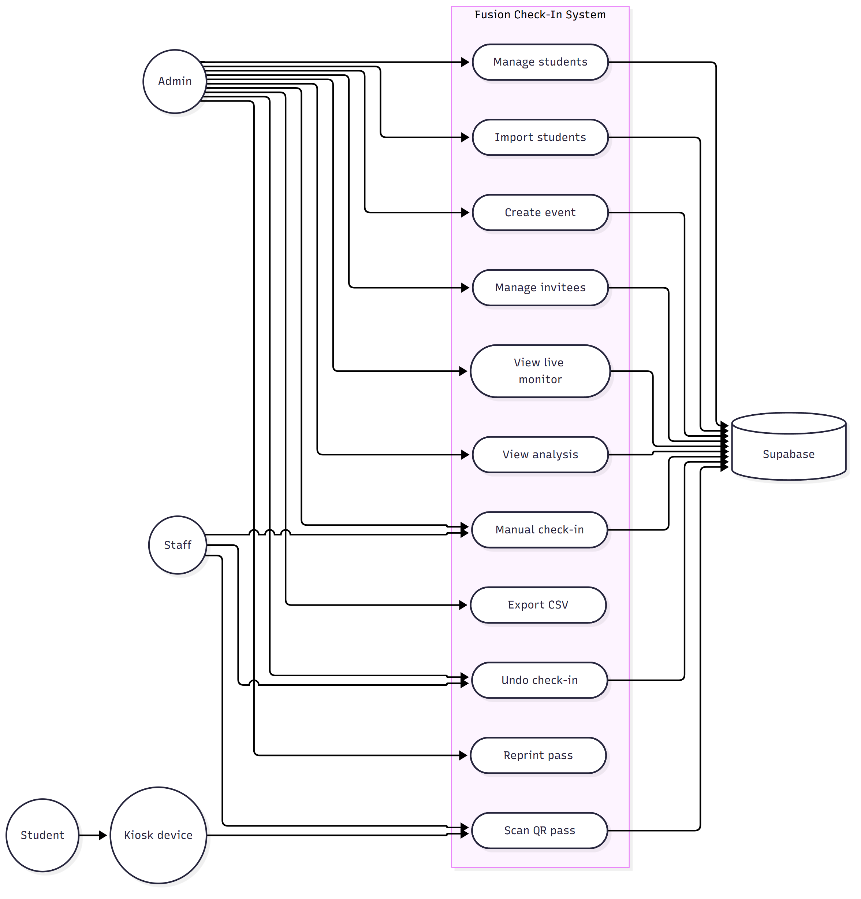

**Figure 2. Class Diagram.** Student, Event, Session, Pass, CheckIn, InviteePeriod, and StaffUser,
with their fields and relationships.

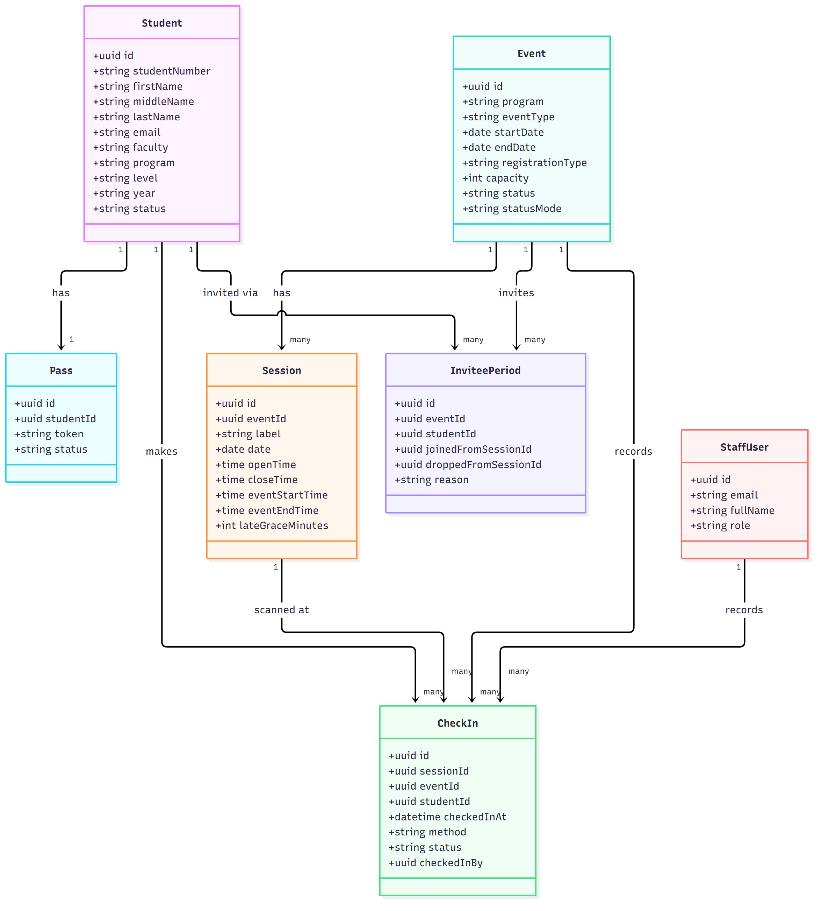

**Figure 3. Entity Relationship Diagram.** All active tables, their primary and foreign keys, and
cardinality.

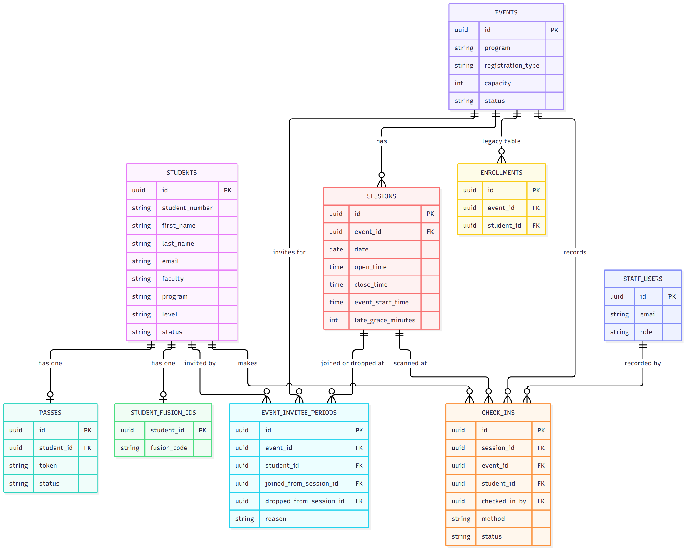

**Figure 4. Sequence Diagram: Kiosk check-in.** From the student's scan through to the Live
Monitor update.

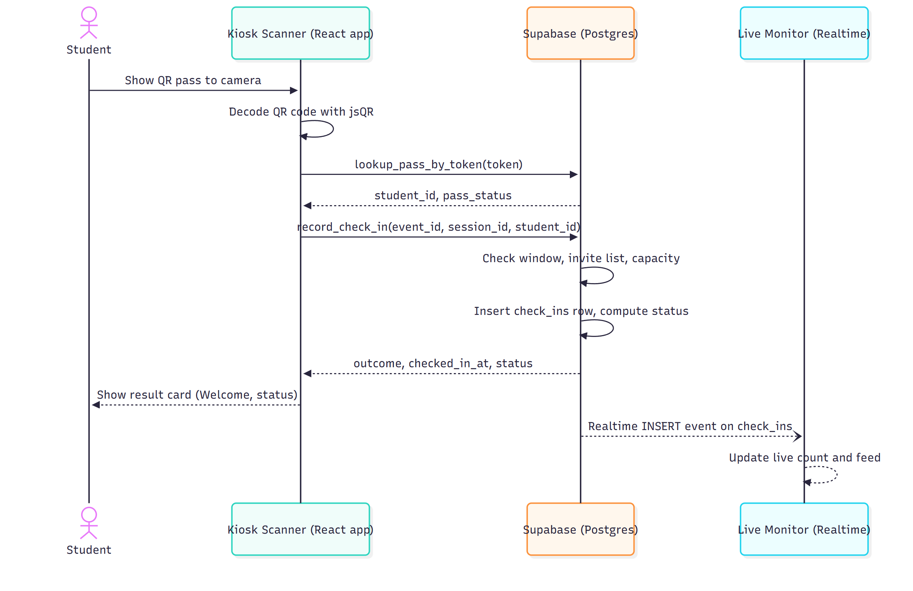

**Figure 5. Sequence Diagram: creating an Invite-only event.** Creating the event and adding
invitees to its roster.

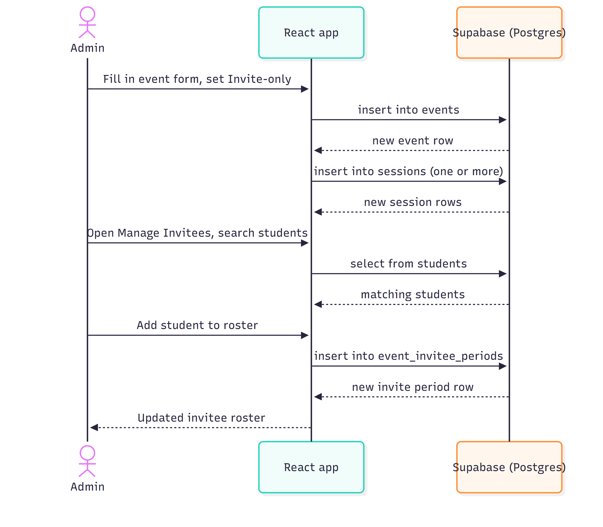

**Figure 6. Sequence Diagram: staff manual check-in and undo.**

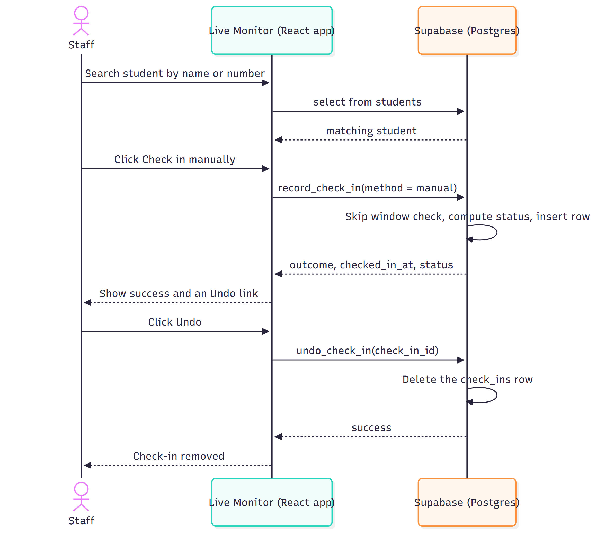

**Figure 7. Activity Diagram: check-in decision flow.** The full decision flow inside
record_check_in, from the initial request through to Early, On time, or Late.

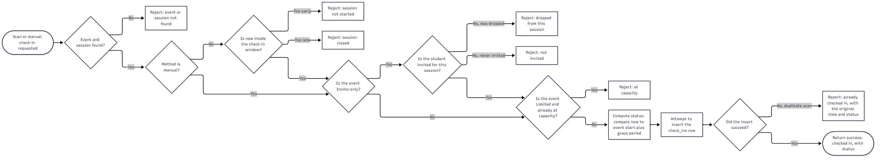

**Figure 8. State Diagram: event lifecycle.** From Upcoming through Active to Completed.

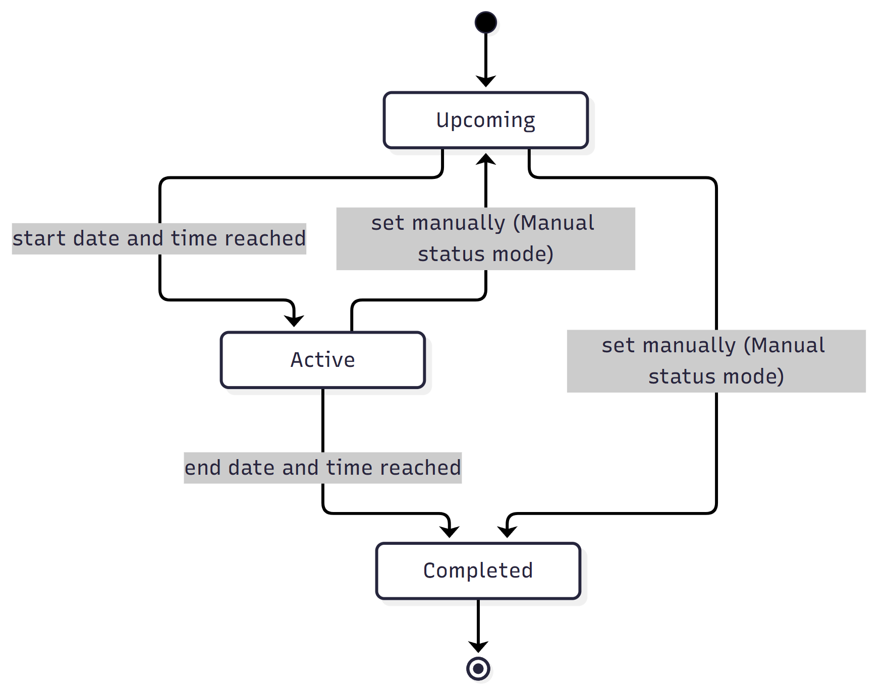

**Figure 9. State Diagram: pass lifecycle.** Between Active and Revoked.

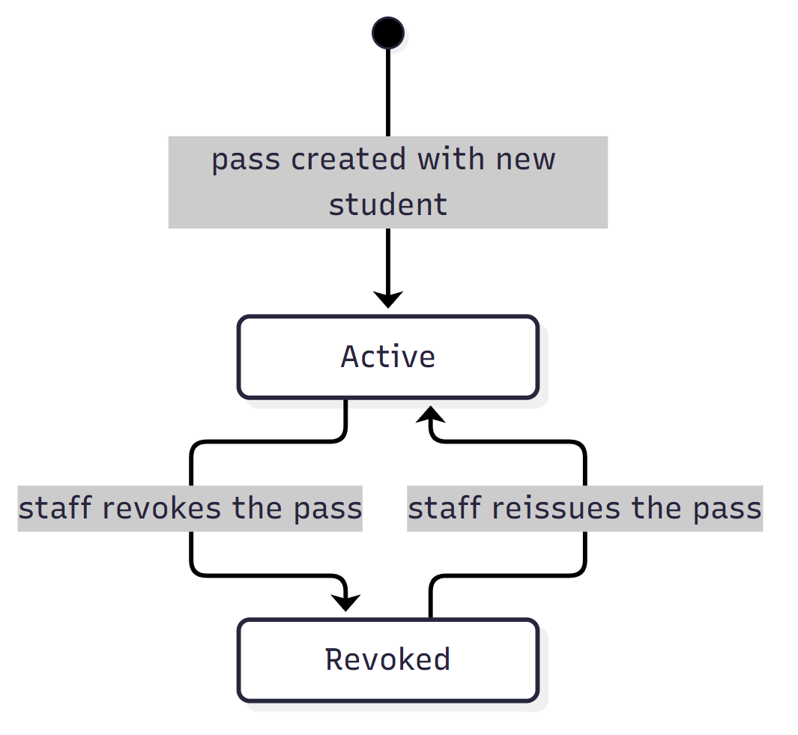

**Figure 10. State Diagram: check-in status lifecycle.** Set once at check-in time and never
recomputed.

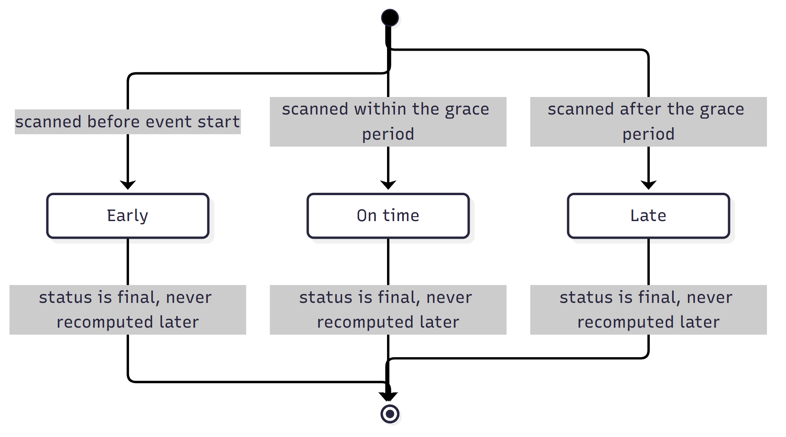

**Figure 11. Component Diagram.** The browser application's own parts, and the Supabase services
they talk to.

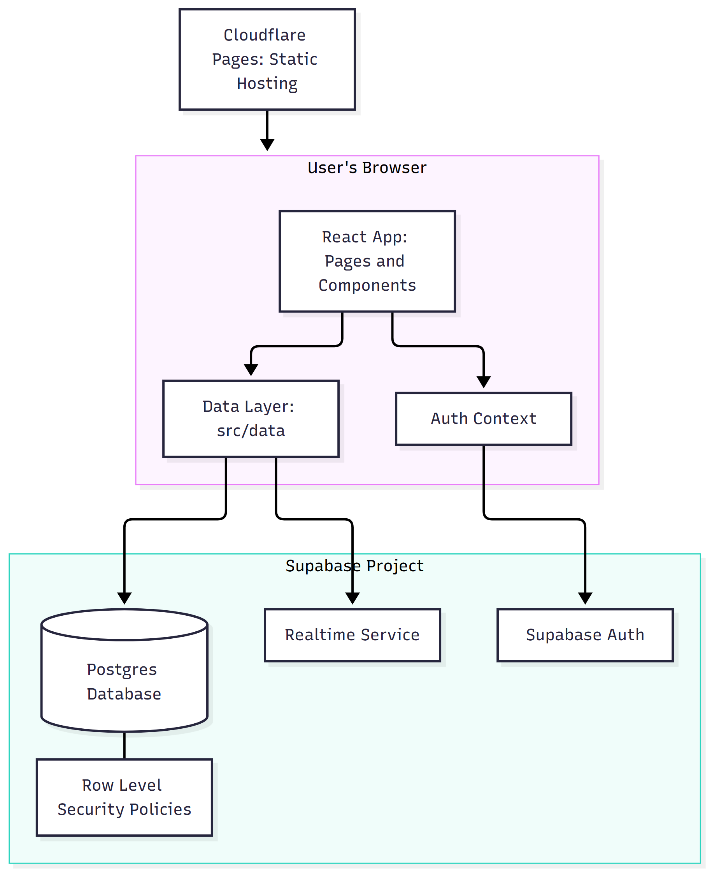

**Figure 12. Deployment Diagram.** User devices, Cloudflare Pages, and the Supabase project.

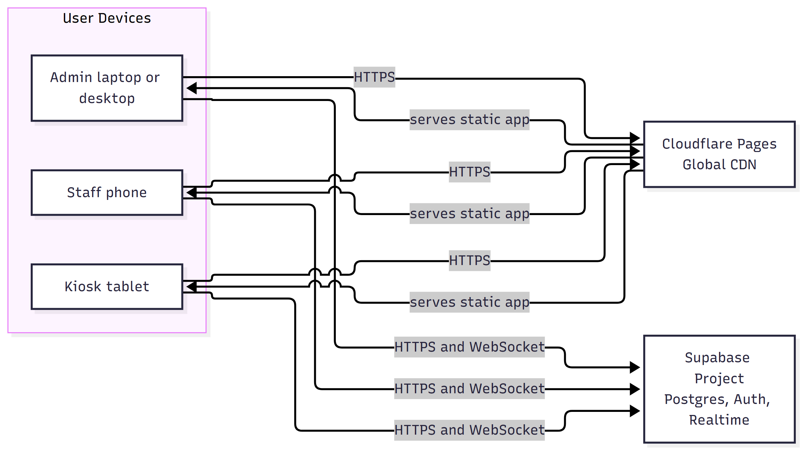

---

## 13. Security

### 13.1 Authentication

Sign-in uses Supabase Auth with email and password. A successful Supabase sign-in is not, by
itself, enough to use the application: after signing in, the system looks up a matching row in
staff_users by email. If none exists, the session is immediately signed back out and the user is
told their account is not authorized as Fusion staff. The staff_users row, not Supabase Auth
membership alone, is the real source of authorization.

Each login page additionally gates by role: the Admin login page signs out and rejects any account
that is not an Admin; the staff scanner login page rejects a Kiosk account; the kiosk login page
rejects any account that is not a Kiosk account.

A "stay signed in on this device" choice controls whether the session is kept in the browser's
persistent storage (survives closing the browser) or its session-only storage (cleared when the
browser closes), and switching this setting actively clears whichever store is not in use, so a
stale session cannot be left behind.

### 13.2 Roles

Three roles exist: Admin, Staff, and Kiosk. See Section 2.2 for what each can access. Role is
stored on staff_users.role and enforced in both the application's routing and the database's Row
Level Security policies, so a client cannot bypass a role restriction by calling the database
directly.

### 13.3 Row Level Security

Every table has Row Level Security enabled. Every policy in the system is scoped to authenticated
users only; there is no anonymous or public access path at the database level anywhere in this
system. In summary:

| Table | Access rule, in plain terms |
|---|---|
| students, events, sessions, check_ins, event_invitee_periods, student_fusion_ids | Any signed-in staff account may read; most allow insert and update by any signed-in staff account; delete is limited to the specific tables where it is needed |
| passes | Any signed-in staff account may see a row's id, student_id, status, and created_at; the token column itself cannot be read directly by any client, at any role |
| staff_users | A user may always read their own row; only an Admin may read every row, or update or delete any account |

### 13.4 QR Token Handling

A QR code encodes only the pass's own random token, a 32 character hex string. It never encodes a
student number or any other identifying value, and it is never a URL, so a generic camera app or a
tool like Google Lens treats it as inert text rather than a clickable link. The token can only be
resolved to a student through the lookup_pass_by_token database function, which any signed-in staff
account may call; the raw token itself can only be read back out through get_pass_token, which is
Admin-only. There is no direct client read path to the passes.token column at all.

### 13.5 Student Data Privacy

Student records are only readable by a signed-in staff account; there is no public or
student-facing login in this system. A student's QR pass identifies them only by an opaque token,
not by any personal information printed or encoded on it beyond their own name on the printed PDF
itself.

### 13.6 Secrets

The application needs two configuration values to reach its Supabase project: a project URL and a
public ("anon") API key. Both are read from environment variables at build time; see Section 14. No
secret values are included in this document.

---

## 14. Deployment Guide

### 14.1 Environments

There is one deployed environment: production, served by Cloudflare Pages at
fusion-check-in-567.pages.dev, on the fusionhub branch of the Cloudflare Pages project. The
database is one Supabase project, shared by local development and production; there is no separate
staging database documented in this repository.

### 14.2 Environment Variables

| Name | Purpose |
|---|---|
| VITE_SUPABASE_URL | The Supabase project's URL |
| VITE_SUPABASE_ANON_KEY | The Supabase project's public (anon) API key |

Both are read by Vite at build time (any variable prefixed VITE_ is exposed to the client bundle).
They are set in a local .env file for development; see .env.example for the expected names. Values
themselves are not recorded in this document.

### 14.3 Build Steps

```bash
npm install
npm run build        # runs: tsc -b, then vite build
```

The build first type-checks the whole project with the TypeScript compiler, then produces a static
production bundle in the dist/ folder.

### 14.4 Deploying to Cloudflare Pages

```bash
npx wrangler pages deploy dist --project-name=fusion-check-in --branch=fusionhub
```

This uploads the contents of dist/ to the fusionhub branch of the fusion-check-in Cloudflare Pages
project. Cloudflare's edge network can take a short time to fully propagate a new deployment, so it
is good practice to verify the live site is serving the new build's own file names before
considering a deploy finished.

### 14.5 Database Changes

Database changes are independent of an application deploy. A new SQL file under supabase/ is
reviewed and then run directly in the Supabase SQL editor; deploying a new build of the application
does not, by itself, apply any database change.

---

## 15. Installation and Local Setup

### 15.1 Prerequisites

- Node.js 20 or newer
- A Supabase project, with the schema set up (see 15.3)

### 15.2 Clone and Install

```bash
git clone https://github.com/saibharathuwin/fusion-check-in.git
cd fusion-check-in
npm install
cp .env.example .env
```

Fill in VITE_SUPABASE_URL and VITE_SUPABASE_ANON_KEY in the new .env file.

### 15.3 Database Setup

Run the SQL files under supabase/ against the target Supabase project, in a sensible order
(seed.sql first, establishing the base tables, followed by the schema-*.sql files). Each file
documents, in its own header comment, what it changes and why.

### 15.4 Run Locally

```bash
npm run dev
```

Starts the Vite development server, with hot module reloading.

### 15.5 Other Commands

| Command | Purpose |
|---|---|
| npm run lint | Runs ESLint across the project |
| npm test | Runs the Vitest test suite once |
| npm run preview | Serves a production build locally, for a final check before deploying |

---

## 16. Testing

### 16.1 Running the Tests

```bash
npm test
```

Runs the full Vitest suite once and exits (configured as "vitest run" in package.json).

### 16.2 What Is Covered

Automated tests focus on the pure logic that does not depend on React or a live database:
time-window and session-selection rules, the Early/On time/Late calculation, invite period
interpretation, form validation, CSV import row validation, and name/text formatting helpers.

| Test file | Covers |
|---|---|
| sessionsData.test.ts | sessionWindowStatus and pickOpenSession, including overlapping-window scenarios |
| checkInStatus.test.ts | Early/On time/Late boundaries around event start and grace period |
| recordCheckInFlow.test.ts | The decision flow mirrored from the record_check_in SQL function |
| inviteePeriods.test.ts | Who is covered by a session, who has been dropped, who joined late or rejoined |
| sessionDays.test.ts | Grouping sessions by day, including which day counts as "today" |
| commonAttendance.test.ts | Finding students who attended every session in a scope |
| addEventData.test.ts | Event and session form validation, and generating sessions across a day range |
| csvImportData.test.ts | Required-field validation for an imported student row |
| smartImport.test.ts | Cleaning up messy imported spreadsheet data |
| nameCase.test.ts | Correcting all-caps or all-lowercase names |
| facultyProgramLookup.test.ts | Matching a typed faculty name to a known faculty |
| downloadAllPasses.test.ts | Choosing unique file names when bulk-downloading passes |
| timeUtils.test.ts | Time formatting helpers |

### 16.3 Known Gaps

- No end-to-end (browser-driven) automated tests are included in the repository; UI flows are verified manually.
- Database functions (record_check_in and others) are not tested by calling a live database in the automated suite; their decision logic is instead mirrored and tested on the application side (recordCheckInFlow.test.ts), so the two must be kept in agreement by hand when either changes.
- Authentication and Row Level Security are not covered by the automated test suite.

---

## 17. Known Issues and Limitations

- staff_users was created before SQL migrations were tracked in this repository, so its exact column definitions are not fully version-controlled; see the note in Section 8.
- event_invitees and event_invitee_drops, the superseded invite-tracking tables, still exist in the database. They are not read or written by the application, but have not been formally removed.
- The enrollments table is seeded with sample data and still exists, but is not part of the real registration or attendance logic; it is read only to warn an Admin before deleting an event.
- Camera mirroring direction cannot be reliably auto-detected across devices; it is handled with a manual, per-device, per-camera preference rather than automatic detection.
- Downloading every student's pass in one bulk ZIP is an Admin-only operation at the database level; a Staff account running it will see most passes reported as skipped rather than included.
- There is a single, shared production database; this document does not describe a separate staging or test database.

---

## 18. Future Improvements

- Drop the superseded event_invitees and event_invitee_drops tables once their replacement, event_invitee_periods, has been confirmed stable, to simplify the schema.
- Bring staff_users under version control with a proper CREATE TABLE migration, so the whole schema can be rebuilt from the files in supabase/ alone.
- Add automated end-to-end tests covering the Kiosk and Staff scanning flows in a real browser.
- Add a staging database and environment, separate from production, for safer testing of schema changes.
- Allow a Staff account to download a bulk ZIP of passes without hitting the current Admin-only restriction, if that workflow is needed by Staff in practice.

---

## 19. Maintenance and Troubleshooting

### 19.1 Routine Maintenance

- Review and apply new SQL files under supabase/ directly in the Supabase SQL editor when a change is introduced; each file's own header comment explains what it does and why.
- Keep dependencies reasonably current using npm, and re-run the full check (type-check, lint, test, build) after any update.

### 19.2 Common Problems

| Symptom | Likely cause and fix |
|---|---|
| A user cannot sign in even with a correct password | Their email has no matching row in staff_users, or they are signing in on the wrong login page for their role; see Section 13.1 |
| A scan is rejected as "session not started" or "session closed" | Working as designed: the current time is outside the session's check-in window; a manual check-in bypasses this |
| A scan is rejected as "not invited" | The event is Invite-only and the student has no invite period covering this session; check the event's invite roster |
| The Live Monitor is not updating in real time | Check that the browser's Realtime (WebSocket) connection to Supabase is active; the page also falls back to a slower periodic refresh |
| A deployed change does not appear to be live | Cloudflare's edge network can take a short time to propagate; compare the live site's built file name to the local build's output |
| The live camera picture looks mirrored incorrectly on one specific device | Use the device's own flip toggle on the scanner screen; some older Android devices need this set once per device |

---

## 20. Appendix A: Glossary

| Term | Meaning |
|---|---|
| Check-in window | The open_time to close_time range during which a session will accept a scan at all |
| Event schedule | A session's event_start_time and event_end_time: its real, advertised time, used only to judge Early/On time/Late |
| Grace period | The number of minutes after event_start_time during which a check-in still counts as On time |
| Invite period | One continuous stretch of time a student is invited to an event, from an optional join point to an optional drop point |
| No-show | A student invited to an event who never checked in to any of its sessions |
| Open session | A session whose check-in window is currently open |
| Outcome | The specific result record_check_in reports back for one check-in attempt, such as checked_in or at_capacity |
| Realtime | Supabase's feature for pushing database changes to a connected browser as they happen |
| Registration type | Whether an event is Open (anyone may attend), Limited (capacity cap), or Invite-only |
| Token | The random value encoded in a student's QR pass, used to identify them without exposing any personal data |

---

## 21. Appendix B: Change Log

| Version | Date | Change |
|---|---|---|
| v1.0 | October 20, 2026 | First complete formal software documentation, covering the application and database as deployed at this date |

*To be confirmed: a detailed, dated history of individual schema and feature changes before this
document existed. The supabase/ folder's own file names and header comments are the most complete
record of that history.*
